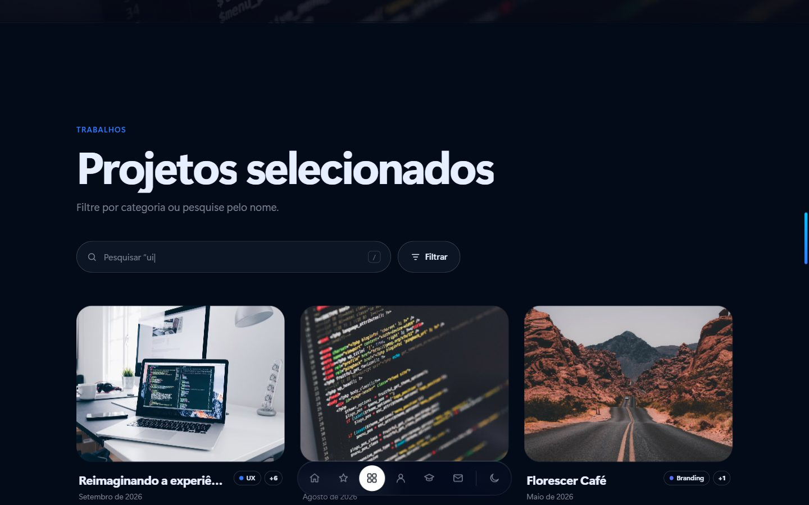
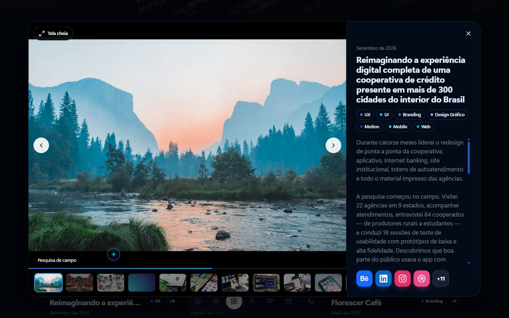
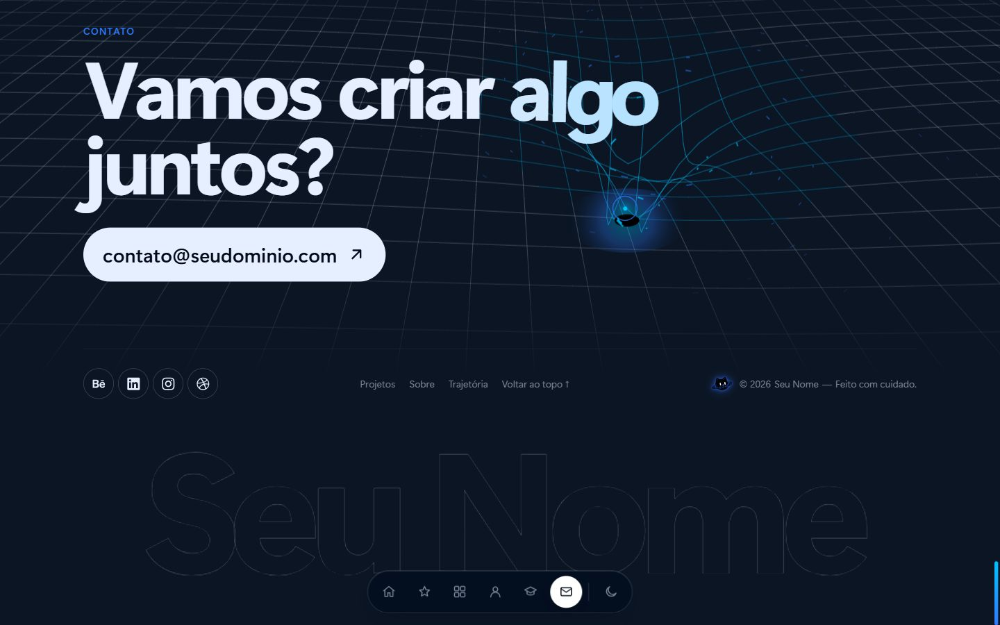
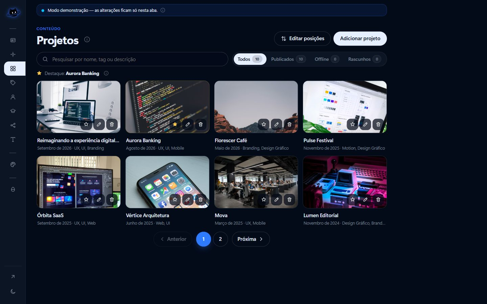
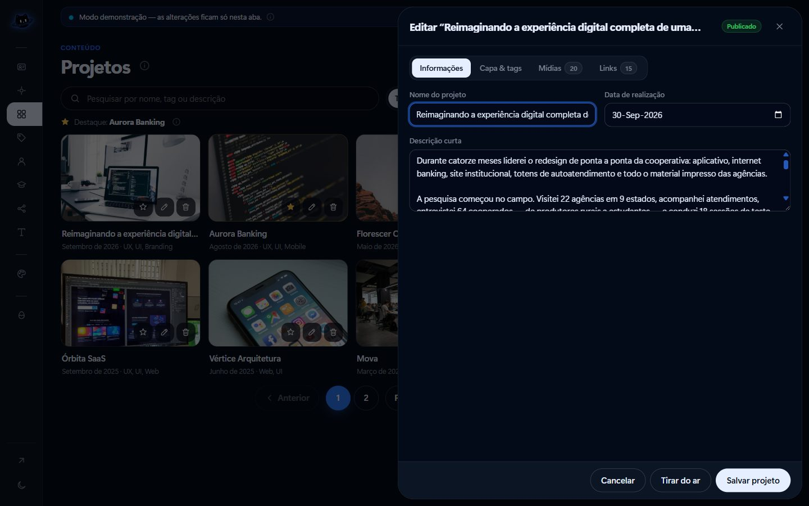
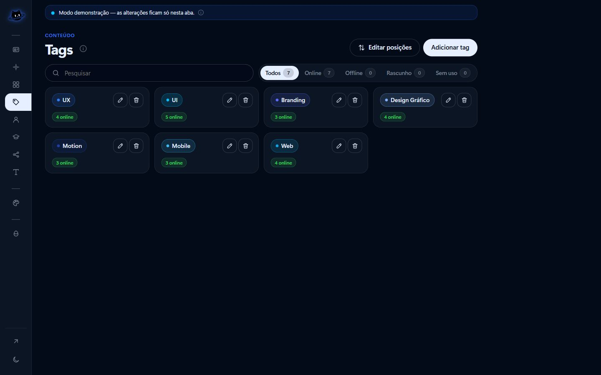
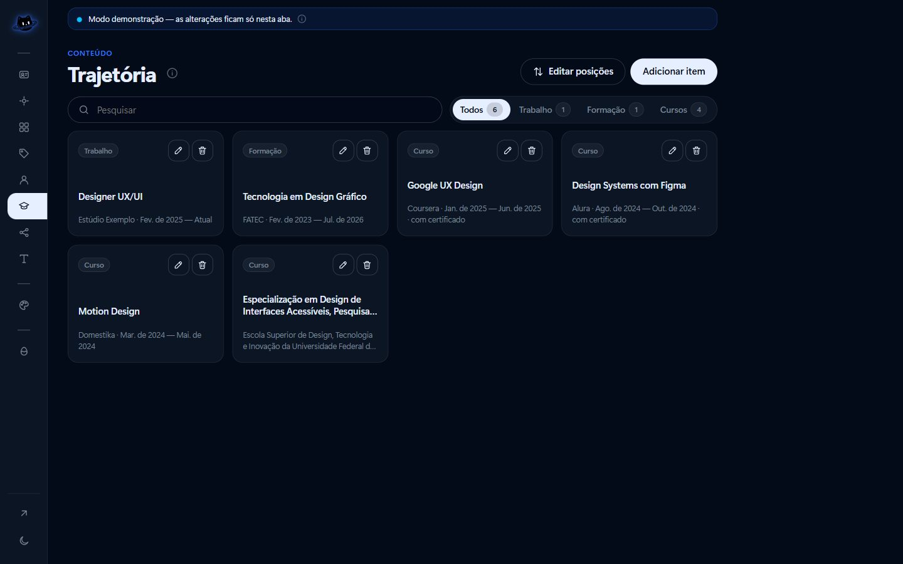
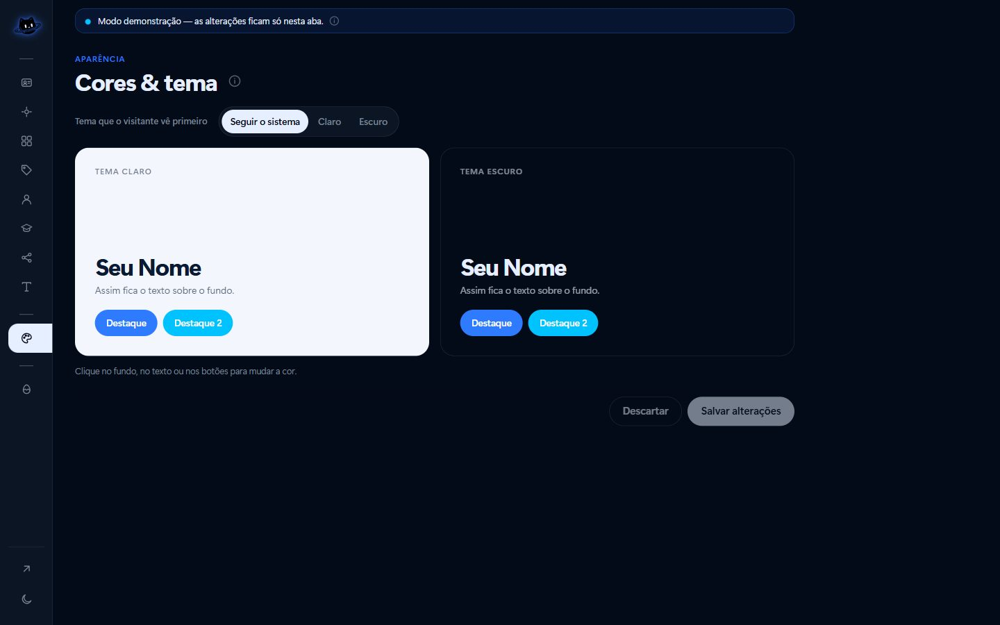
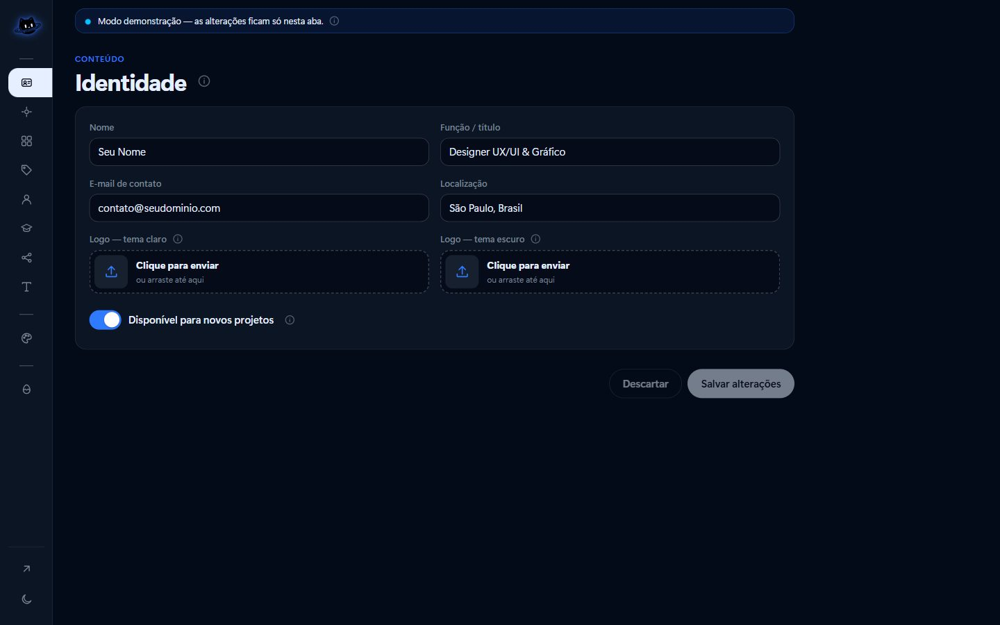
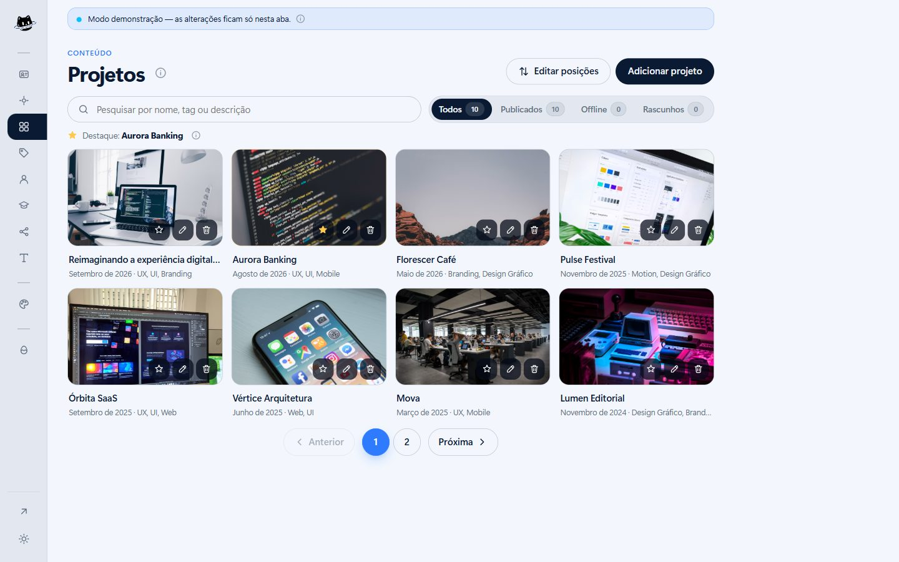

# Portfólio — Designer UX/UI & Gráfico

Dois sites que conversam com o mesmo banco no **Supabase**:

| Site | Caminho | O que faz |
| ---- | ------- | --------- |
| **Portfólio** | `/` | Hero com buraco negro animado (canvas): as letras são atraídas pelo cursor e, ao chegar perto do buraco, entram em órbita e voltam letra por letra. No **tema claro** ele vira um **buraco branco** numa nebulosa: empurra as letras e arremessa o hero para longe. Também tem dock flutuante só com ícones, faixa de habilidades com lupa, cursor elástico, projeto destaque que abre por um portal, projetos com pesquisa + filtro por tags e paginação (6 por página), modal com galeria de imagens e vídeos, sobre mim, trajetória (trabalho atual, formação, cursos e certificados), contato com a malha do espaço-tempo, redes sociais, tema claro/escuro e rodapé. |
| **Painel** | `/admin/` | Login e edição de **tudo** o que aparece no portfólio: textos, imagens, vídeos, tags, links, cores, logos e tema. Mesmo visual, com o buraco negro (ou branco) só na tela de login. |
| **404** | qualquer endereço que não existe | Uma página só para os dois sites, com o "404" e o gato puxados (ou empurrados) pelo cursor e botão de tema. Em `/admin/...` ela mostra os botões do painel. |
| **IDV Visual** | `/idv/` | Identidade visual da marca (logos para baixar, cores, tipografia) e do site e do painel. |

## Telas

### Portfólio

 
 
 
 
 

### Painel

 
 
 
 

## Feito para ser leve

- **HTML, CSS e JavaScript puros**: sem framework e sem build. O `node_modules` só existe para o script de instalação do banco (`npm run setup`); o site não usa nada dele.
- O que carrega ao abrir o portfólio pesa **~70 KB comprimido** (código, estilos e ícones). O resto (destaque, habilidades, fundo do contato, easter eggs) só é baixado quando aparece na tela ou é ativado.
- O site público **não carrega o SDK do Supabase**: faz **uma única requisição** (`get_portfolio()`) que devolve tudo em JSON.
- **Cache local**: na segunda visita o conteúdo aparece na hora e é atualizado em segundo plano.
- Animações em canvas param sozinhas fora da tela e com a aba oculta; os efeitos de rolagem só calculam o que está visível.
- Imagens carregam só quando chegam perto da tela; vídeos do YouTube/Vimeo só quando você abre a mídia.
- Respeita `prefers-reduced-motion`: com movimento reduzido, tudo fica estático e legível.

## Estrutura

```text
portfolio/
├── index.html            # portfólio
├── 404.html              # página de "não encontrado" (site e painel)
├── dev-server.py         # servidor local sem cache (mostra o 404.html como a hospedagem)
├── assets/
│   ├── site.css          # estilos + efeitos
│   ├── site.js           # renderização, filtros, modal, dock, cursor, órbita, gravidade
│   ├── blackhole.js      # buraco negro/branco do hero, do login e do 404 (canvas 2D)
│   ├── portal.js         # buraco do projeto destaque (carregado sob demanda)
│   ├── spacetime.js      # malha do espaço-tempo no contato (carregado sob demanda)
│   ├── skills.js         # habilidades em cards com ícone (carregado sob demanda)
│   └── easter.js         # easter eggs (carregado só quando ativado)
├── admin/
│   ├── index.html        # painel
│   ├── admin.css
│   ├── admin.js
│   └── demo-login.js     # login de teste do modo demonstração (fora do Git)
├── shared/               # usado pelos dois sites
│   ├── config.js         # ← URL e chave do Supabase
│   ├── tokens.css        # cores, tipografia, botões, campos
│   ├── api.js            # busca de dados (fetch) + utilitários
│   ├── theme.js          # tema claro/escuro e cores do banco
│   ├── gravity.js        # letras puxadas (escuro) ou empurradas (claro) pelo cursor
│   ├── logo.js           # o gato do mkrosz em SVG (normal, com brilho e do buraco branco)
│   ├── placeholder.js    # arte de espera das imagens
│   ├── platforms.js      # Behance, LinkedIn, Instagram, site...
│   ├── brand-paths.js    # ícones SVG das marcas (Simple Icons, CC0)
│   ├── tool-paths.js     # ícones das ferramentas das habilidades
│   ├── notfound.css/.js  # página 404
│   ├── favicon.svg
│   └── demo-data.js      # dados de exemplo (usados sem Supabase)
├── idv/                  # identidade visual + logos para baixar (idv/exportar/)
├── scripts/
│   ├── setup-supabase.mjs  # instala o banco inteiro (npm run setup)
│   └── backup-storage.mjs  # baixa os arquivos do bucket (usado no backup)
├── .github/workflows/
│   └── backup.yml        # backup semanal do banco e dos arquivos (GitHub Actions)
└── supabase/
    └── schema.sql        # tabelas, RLS, triggers, funções e storage
```

## Rodar localmente

Dentro da pasta `portfolio/`:

```bash
python dev-server.py
```

É um servidor estático simples, sem cache: depois de editar um arquivo, basta recarregar a página. Ele também mostra o `404.html` em endereços que não existem, igual à hospedagem.

Abra `http://localhost:5500` (portfólio), `http://localhost:5500/admin/` (painel) e `http://localhost:5500/idv/` (identidade visual).

Sem Supabase configurado, os dois rodam em **modo demonstração**: o portfólio mostra projetos de exemplo e o painel deixa você testar tudo, mas as alterações não são salvas. O login de teste fica em `admin/demo-login.js` (só o painel baixa esse arquivo, e só nesse modo); sem ele, o painel avisa que não há login de teste.

## Configurar o Supabase (gratuito)

### Jeito rápido: um comando

Precisa do **Node 22.9 ou mais novo**. Crie o projeto em [supabase.com](https://supabase.com) e, na pasta `portfolio/`, rode:

```bash
npm install
```

```bash
npm run setup
```

O script pergunta (ou lê do arquivo `.env`, copiado de `.env.example`) a connection string do banco, a Project URL, a anon key e o seu e-mail, e faz tudo sozinho:

1. roda o `supabase/schema.sql` inteiro: tabelas, regras/policies (RLS), funções, triggers, bucket `media` (com limite de 50 MB e só imagens, vídeos e PDF) e dados iniciais;
2. torna o seu e-mail administrador, e cria o usuário se ele ainda não existir e você informar a `service_role` key e uma senha (8 caracteres ou mais);
3. grava a URL e a anon key em `shared/config.js`.

Pode rodar de novo sempre que o `schema.sql` mudar: ele só cria ou atualiza o que falta, sem apagar conteúdo (a não ser colunas que o projeto deixou de usar).

Onde achar cada dado:

- **Connection string**: Project Settings → Database → Connection string (URI). Se a sua rede for só IPv4 e a conexão direta falhar, use a do **Session pooler**. Se a senha do banco tiver `@`, `#` ou `/`, troque esses caracteres pelo código (`%40`, `%23`, `%2F`).
- **URL e chaves**: Project Settings → API.

Depois do script, faça os passos 6 e 7 abaixo (eles são no painel do Supabase).

### Passo a passo manual

1. Crie um projeto em [supabase.com](https://supabase.com).
2. Em **SQL Editor**, cole e rode o arquivo [`supabase/schema.sql`](supabase/schema.sql) inteiro. Ele cria:
   - **Tabelas**: `settings`, `projects`, `project_media`, `project_links`, `project_tags`, `tags`, `education`, `social_links`, `admins`.
   - **Policies (RLS)**: qualquer pessoa **lê** o conteúdo publicado; só quem está em `admins` **escreve**. Projetos em rascunho ou offline ficam invisíveis no site.
   - **Triggers**: `updated_at` automático e `slug` gerado a partir do título/nome.
   - **Funções**: `get_portfolio()` (site público, uma requisição) e `save_project()` (painel salva projeto + tags + mídias + links numa transação).
   - **Storage**: bucket público `media` para imagens, vídeos e certificados. Os arquivos abrem pela URL, mas só o admin lista, envia e apaga. O painel apaga sozinho os arquivos que deixam de ser usados.
3. Em **Authentication → Users → Add user**, crie seu usuário (e-mail e senha).
4. No **SQL Editor**, torne esse usuário administrador (troque o e-mail):

   ```sql
   insert into public.admins (user_id)
   select id from auth.users where email = 'seu-email@exemplo.com';
   ```

5. Em **Project Settings → API**, copie a **Project URL** e a **anon public key** para `shared/config.js`.
6. Em **Authentication → URL Configuration**:
   - **Site URL**: o endereço do painel (ex.: `https://seu-site.com/admin/`).
   - **Redirect URLs**: `https://seu-site.com/admin/**` e, para testar no computador, `http://localhost:5500/admin/**`. É para lá que voltam os links de e-mail de **"Esqueci minha senha"** e de **troca de e-mail** (o `**` aceita o `?recuperar=1` que o painel coloca no link).
7. Em **Authentication → Sign In / Providers**, desligue **"Allow new users to sign up"**: só você entra, e ninguém cria conta sozinho.

### Ligar o banco no site publicado (Vercel)

O site não tem build nem variáveis de ambiente: ele lê a URL e a chave pública do arquivo `shared/config.js`. Então ligar o banco é preencher esse arquivo e publicar de novo.

1. Faça o **Jeito rápido** acima no seu computador (`npm install` e `npm run setup`). No fim, o `shared/config.js` fica preenchido com a Project URL e a anon key.
2. Envie essa mudança para o GitHub (commit e push). A Vercel publica de novo sozinha em cerca de um minuto. A anon key pode ir para o repositório público: quem protege os dados são as regras (RLS) do banco.
3. No Supabase, em **Authentication → URL Configuration**, use o endereço da Vercel: **Site URL** `https://seu-projeto.vercel.app/admin/` e, em **Redirect URLs**, `https://seu-projeto.vercel.app/admin/**` (e o seu domínio próprio, se tiver).
4. Desligue o cadastro público (passo 7 do passo a passo manual).
5. Abra `https://seu-projeto.vercel.app/admin/`, entre com o e-mail e a senha do admin e preencha o conteúdo. O site passa a mostrar o que estiver no banco.

Na Vercel não precisa configurar nada: o projeto é estático (Framework Preset **Other**, sem comando de build, pasta raiz `./`). A integração "Supabase" da Vercel não é necessária, porque ela só cria variáveis de ambiente, que este site não usa.

### E-mails (recuperar senha e trocar e-mail)

O envio de e-mail padrão do Supabase é só para testes: manda poucos e-mails por hora e, em projetos novos, só para membros da equipe do projeto. Para os links de "Esqueci minha senha" chegarem de verdade, configure um **SMTP próprio** em **Authentication → Emails → SMTP Settings** (Resend, Brevo, Gmail com senha de app…) e, se quiser, traduza os modelos de e-mail para português na mesma tela.

### Login e perfil

- **Entrar**: e-mail e senha do usuário criado no passo 3. Só quem está na tabela `admins` consegue editar: as policies barram qualquer outra conta, mesmo que ela faça login.
- **Esqueci minha senha**: na tela de login. Chega um link por e-mail que abre o painel pedindo a senha nova.
- **Meu perfil**: clique no seu nome, no topo do menu lateral. Dá para trocar o e-mail (confirmado por um link enviado ao novo endereço) e a senha (pede a senha atual).

> A anon key é pública por design: quem protege os dados são as policies do `schema.sql`. Nunca coloque a `service_role` key no front-end.

### Backup semanal (GitHub Actions)

O plano gratuito não tem backup que você consiga baixar, e o projeto **pausa depois de 7 dias sem uso**. O arquivo `.github/workflows/backup.yml` resolve os dois: toda segunda-feira (3h, horário de Brasília) o GitHub copia o banco e todos os arquivos do bucket `media`, criptografa tudo e guarda por 90 dias. Esse acesso semanal também mantém o projeto ativo.

Para ligar, no repositório do portfólio no GitHub, vá em **Settings → Secrets and variables → Actions → New repository secret** e crie:

| Segredo | Onde achar |
| ------- | ---------- |
| `SUPABASE_DB_URL` | Supabase → **Connect** → **Session pooler** (o GitHub só tem IPv4; a conexão direta não funciona lá). Com a senha do banco no lugar de `[YOUR-PASSWORD]`. |
| `SUPABASE_URL` | Project Settings → API → Project URL |
| `SUPABASE_SERVICE_ROLE_KEY` | Project Settings → API → `service_role` (fica só nos segredos do GitHub) |
| `BACKUP_PASSPHRASE` | Uma senha que você inventa para abrir os backups. **Guarde-a**: sem ela o backup não abre. |

Para testar na hora: **Actions → Backup do Supabase → Run workflow**. Os backups ficam na página de cada execução, em **Artifacts** (`backup-AAAA-MM-DD`).

Para abrir um backup baixado (descompacte o `.zip` do GitHub antes):

```bash
gpg --decrypt backup-AAAA-MM-DD.tar.gz.gpg > backup.tar.gz
```

```bash
tar -xzf backup.tar.gz
```

Dentro vêm o `banco.sql` (os dados do portfólio: textos, projetos, tags, trajetória, redes) e a pasta `storage/` com as imagens, vídeos e certificados. Para restaurar num projeto novo:

1. Rode o `npm run setup` (ou o `schema.sql`): ele cria as tabelas e torna você admin.
2. No SQL Editor, apague os dados de exemplo que o setup criou:

   ```sql
   truncate public.settings, public.social_links, public.tags, public.projects, public.education cascade;
   ```

3. Cole e rode o `banco.sql` no SQL Editor.
4. Envie a pasta `storage/` para o bucket `media` mantendo os mesmos caminhos. Se o endereço do projeto mudou, troque o endereço antigo pelo novo dentro do `banco.sql` antes do passo 3 (as imagens guardam o endereço completo).

## Usando o painel

| Seção | O que você edita |
| ----- | ---------------- |
| Identidade | Nome, função, e-mail, localização, selo "disponível" e logo (uma para o tema claro e outra para o escuro; vazio = o gato padrão) |
| Hero | Texto acima, título (use `*asteriscos*` para destacar palavras), subtítulo, botão |
| Projetos | Nome, data, descrição curta, capa, cor, **tags** (busque uma que já existe ou crie uma nova ali mesmo), **várias imagens e vídeos** (upload ou link do YouTube/Vimeo), **links de publicação** (Behance, LinkedIn, Instagram, site… cada um vira um botão com o ícone da plataforma). Cada projeto pode estar **Publicado**, **Offline** (já foi publicado e saiu do ar) ou em **Rascunho**. A **estrela** escolhe o projeto destaque, que usa o próprio título e descrição do projeto |
| Tags | Todas as tags em cards: renomear, trocar a cor, excluir. A busca e o filtro mostram em quais projetos (online, offline, rascunho) cada tag é usada, e as que não são usadas |
| Sobre mim | Título, texto, foto e habilidades |
| Trajetória | Trabalho, formação e cursos, com datas, certificado (imagem/PDF) e link de validação |
| Redes sociais | Links da navbar e do rodapé (a plataforma é detectada pelo link) |
| Textos & rodapé | Títulos das seções e textos do rodapé |
| Cores & tema | 6 cores (destaque, fundo e texto dos temas claro/escuro) editadas direto na prévia, em HEX, RGB, CMYK, HSV ou HSL, + tema padrão |

Em listas com mais de um item, **Editar posições** mostra as setas para mudar a ordem (em Projetos e Trajetória dá para ordenar pela data). Fechar uma edição ou trocar de seção sem salvar pede confirmação.

Links úteis do portfólio: `/#projeto/slug-do-projeto` abre direto o modal de um projeto, e `/?tag=ux&q=app` abre a lista já filtrada.

## Easter eggs

| Segredo | Como ativar |
| ------- | ----------- |
| 🚀 Nave escondida | Clicar 7 vezes no buraco negro do hero (em até 4 s). Pilote com setas/WASD ou com o mouse e colete as 10 estrelas; `Esc` sai. |
| ⚡ Hiperespaço | Digitar `warp` em qualquer lugar da página (fora da busca). Leva até o fim do site, ou de volta ao topo se você já estiver no fim. |
| 🪐 Gravidade zero | No teclado: ↑ ↓ ↑ ↓ ← → ← → A B (ou o Konami clássico ↑ ↑ ↓ ↓ ← → ← → B A). O que está na tela flutua sem parar, colide entre si e pode ser arrastado/arremessado, inclusive nas seções que aparecem ao rolar; cliques e digitação continuam funcionando. Volta ao normal repetindo o código (ou após 1 min sem interação). |
| 👀 Console | Abrir o console do navegador (`F12`): buraco negro em ASCII, recado com o seu e-mail e dicas dos outros segredos. |

Só um fica ativo por vez: ativar outro desfaz o anterior. O código fica em `assets/easter.js` e só é baixado quando alguém ativa um deles. A lista também aparece no painel, em **Extras → Easter eggs**.

## Publicar

É um site estático, sem comando de build: publique na **Vercel**, **Netlify**, **Cloudflare Pages** ou **GitHub Pages**. O painel fica em `/admin/`.

- **Página 404**: todas essas hospedagens mostram o `/404.html` em qualquer endereço que não existe, inclusive em `/admin/...` (a página troca os botões sozinha). Os caminhos dela começam na raiz do domínio, então publique o site na raiz (`seu-site.com`), e não numa subpasta como `usuario.github.io/repositorio/`.
- **O que não precisa ir para o ar**: `node_modules/`, `scripts/`, `supabase/`, `.github/`, `package.json`, `package-lock.json`, `.env.example`, `dev-server.py` e `README.md` são só para instalar e desenvolver. A pasta `idv/` é pública se for junto. Na Vercel e na Netlify dá para apontar o deploy para a pasta e ignorar esses arquivos; no GitHub Pages, publique a partir de uma pasta só com o site.
- **Login de teste**: `admin/demo-login.js` está no `.gitignore` e não vai junto se você publicar pelo Git. Com o Supabase configurado ele nem é usado.

Dica de leveza: envie imagens em **WebP** ou **AVIF** com no máximo ~2000 px de largura, e vídeos curtos em MP4 (H.264), ou hospede vídeos longos no YouTube/Vimeo e cole o link. O limite por arquivo é 50 MB.
